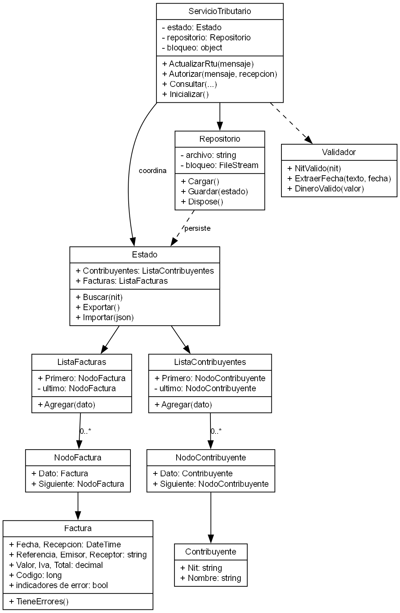
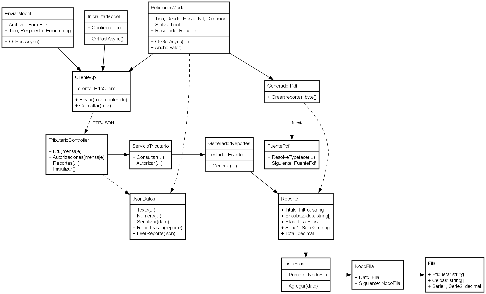
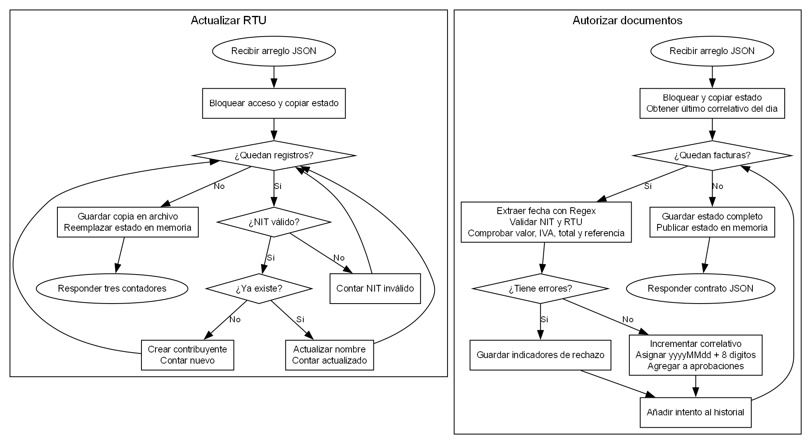
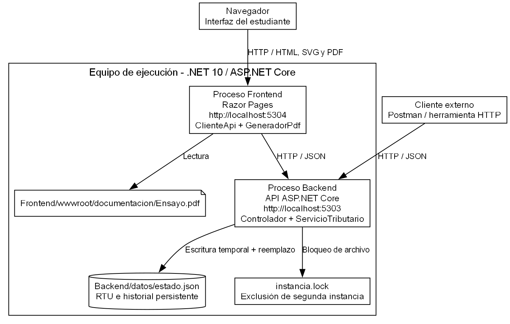
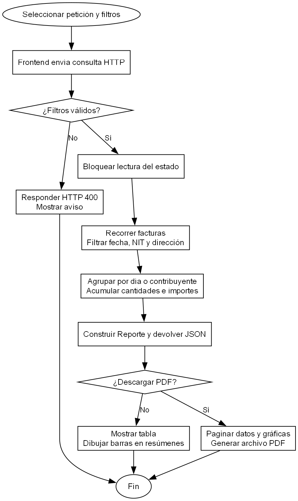

# AUTORIZACIÓN DE DOCUMENTOS TRIBUTARIOS MEDIANTE UNA API CON PERSISTENCIA Y VALIDACIÓN EN C#

202505232 - Angel Daniel Ruiz Ramos - Sección C

## Resumen

Este ensayo examina el diseño de un servicio de autorización de documentos tributarios electrónicos y su relación con la integridad de la información. El problema consiste en recibir solicitudes JSON, verificar contribuyentes y cálculos monetarios, emitir códigos únicos y conservar resultados para consultas posteriores. Se sostiene que una respuesta correcta depende de coordinar validación, almacenamiento y comunicación, además de implementar las operaciones individuales. La solución separa una interfaz Razor Pages de una API desarrollada en C#, emplea listas enlazadas propias y utiliza archivos para mantener el registro tributario y el historial de solicitudes. Las expresiones regulares permiten extraer fechas sin rechazar el texto adicional que acompaña al mensaje. El análisis considera correlativos diarios, referencias duplicadas, concurrencia, reportes y recuperación ante errores de escritura. Desde una perspectiva técnica, la propuesta hace explícitas las decisiones que condicionan la interpretación de estadísticas y montos. Se concluye que la trazabilidad y la persistencia verificable son necesarias para que una autorización conserve su significado después de reiniciar el servicio.

Palabras clave: Autorización, persistencia, validación, trazabilidad, concurrencia.

## Abstract

This essay examines the design of an electronic tax document authorization service and its relationship with information integrity. The problem involves receiving JSON requests, checking taxpayers and monetary calculations, issuing unique codes, and retaining results for subsequent queries. It argues that a correct response depends on coordinating validation, storage, and communication, as well as implementing individual operations. The solution separates a Razor Pages interface from an API developed in C#, uses custom linked lists, and stores the taxpayer registry and request history in files. Regular expressions extract dates without rejecting additional text accompanying the message. The analysis considers daily sequences, duplicate references, concurrency, reports, and recovery from write failures. From a technical perspective, the proposal makes explicit the decisions that affect the interpretation of statistics and monetary amounts. It concludes that traceability and verifiable persistence are necessary for an authorization to retain its meaning after the service restarts.

Keywords: Authorization, persistence, validation, traceability, concurrency.

## Introducción

Autorizar un documento electrónico requiere relacionar reglas de negocio con mecanismos que preserven los resultados. El Proyecto 3 plantea un servicio HTTP que recibe mensajes JSON, verifica datos tributarios y produce consultas desde una aplicación web (Universidad de San Carlos de Guatemala, 2026b). Este ensayo analiza cómo distribuir esas responsabilidades mediante programación orientada a objetos en C#. Su propósito es explicar por qué la validación, la asignación de correlativos y la persistencia deben formar una operación coordinada. También examina la diferencia entre la fecha declarada en una factura y el momento de recepción, así como sus efectos en los reportes. La exposición parte de la arquitectura, desarrolla los algoritmos principales y concluye con sus alcances y límites.

## Desarrollo: objetos y estructuras propias

Contribuyente representa el NIT y el nombre del registro tributario. Factura conserva fecha, recepción, referencia, participantes, importes, autorización e indicadores de error. Estado reúne dos listas enlazadas concretas y ofrece la búsqueda de contribuyentes. Los nodos contienen una referencia al dato y otra al siguiente nodo. La separación permite recorrer el historial sin mezclar los enlaces con las propiedades tributarias. Las clases de dominio no requieren colecciones genéricas ni consultas LINQ.

ServicioTributario coordina las modificaciones y Repositorio conserva el estado en archivos. La figura 1 relaciona los datos, sus nodos, las listas y los servicios. Buscar un NIT recorre hasta c contribuyentes; verificar una referencia recorre hasta f solicitudes. Estas operaciones son secuenciales: no se afirma rendimiento logarítmico ni procesamiento masivo.

Figura 1. Modelo de dominio y persistencia. Fuente: elaboración para esta implementación.

## Comunicación entre frontend y backend

La solución utiliza dos procesos. El frontend contiene páginas Razor para seleccionar archivos, consultar información, descargar reportes y acceder a la documentación. El backend expone una API que puede recibir solicitudes de ese frontend o de un cliente externo. Esta separación permite comprobar las operaciones sin depender de controles visuales. El contrato HTTP constituye el punto de encuentro entre ambas aplicaciones y evita que la interfaz modifique directamente los archivos persistentes.

El envío de un archivo conserva los bytes recibidos. La aplicación web no agrega propiedades ni reconstruye el mensaje antes de transmitirlo. La API interpreta el arreglo JSON y devuelve los nombres de campos establecidos en el enunciado. Esta decisión mantiene la independencia del cliente: una solicitud enviada desde una herramienta HTTP tiene el mismo procesamiento que una solicitud enviada desde la página web. Los errores de estructura JSON se diferencian de los errores de negocio de cada factura.

Las páginas Razor reciben ClienteApi y consumen los reportes mediante HTTP. GeneradorPdf utiliza PDFsharp y FuentePdf resuelve una fuente incluida en el proyecto, que permite conservar los caracteres cubiertos por ella al exportar. El diagrama de la figura 2 muestra las clases que intercambian y representan la información.

Compartir tipos de reporte no implica compartir el estado. El backend conserva las listas y aplica las reglas; el frontend recibe JSON y produce tablas, gráficas y archivos PDF. Las estructuras de dominio siguen siendo listas enlazadas propias.

Figura 2. Clases de comunicación y reportes. Fuente: elaboración para esta implementación.

## Validación y autorización de documentos

Una expresión regular extrae la fecha de TIEMPO y la conversión de calendario comprueba día y hora. Se ignoran nombres de lugares y sufijos. El NIT conserva ceros iniciales y hasta veinte dígitos previos al verificador; los pesos empiezan en dos desde la derecha. El módulo once determina el verificador y el resultado diez corresponde a K.

Los importes se procesan como decimal: VALOR debe ser positivo y tener precisión de centavos. El IVA esperado es el 12 % redondeado a dos posiciones; TOTAL debe ser VALOR más IVA. La referencia admite hasta cuarenta caracteres y no se reutiliza, incluso después de un rechazo o reinicio.

La figura 3 muestra el alta o actualización del RTU y la autorización. Cada factura puede acumular varias causas de rechazo. Los NIT inválidos no modifican el RTU; los válidos existentes actualizan el nombre y los nuevos se incorporan.

El código une la fecha de recepción en Guatemala con ocho dígitos de correlativo. Solo las aprobaciones incrementan la secuencia. TIEMPO determina la fecha de los reportes. La respuesta conserva los campos obligatorios; los demás errores se consultan en las estadísticas.

Figura 3. Actividades de actualización del RTU y autorización. Fuente: elaboración para esta implementación.

## Persistencia y despliegue

El backend carga estado.json al iniciar. Cada modificación se aplica sobre una copia del estado; luego escribe un archivo temporal, reemplaza el archivo definitivo y publica la copia en memoria. Si falla la escritura, no se anuncia éxito y permanece el estado anterior.

El historial conserva el RTU, las referencias y los correlativos. Un bloqueo serializa las operaciones; un archivo exclusivo impide que otro backend utilice la misma carpeta. Estas medidas protegen una instancia local, sin prometer coordinación distribuida.

La figura 4 ubica los dos procesos, el navegador y los archivos. Un cliente externo puede consumir la misma API. La operación Inicializar guarda un estado vacío; un archivo corrupto provoca un fallo de inicio en lugar de borrarse silenciosamente.

El frontend sirve el ensayo y genera los PDF con la fuente empaquetada. La biblioteca PDFsharp se restaura con NuGet al compilar; durante la ejecución no se necesita descargar fuentes. Los datos de prueba usan carpetas independientes de los datos normales.

Figura 4. Despliegue local y almacenamiento. Fuente: elaboración para esta implementación.

## Consultas, gráficas y exportación

El reporte de contribuyente distingue facturas emitidas y recibidas y agrupa las autorizaciones por fecha. Presenta cantidad diaria, monto y total del rango. El listado complementario conserva referencia, participantes, importes y código de autorización.

El resumen de IVA calcula el impuesto emitido y recibido por cada NIT en una fecha. Cuando el contribuyente ocupa ambos extremos, participa en ambas columnas. El resumen por rango permite elegir total con IVA o valor sin IVA.

Las gráficas utilizan barras y valores numéricos. El PDF incluye filtros, resultados, totales y las gráficas correspondientes. La figura 5 describe cómo el backend filtra y agrupa los datos y cómo el frontend los presenta o exporta.

Las estadísticas cuentan todos los intentos, incluidos los rechazados; los montos usan únicamente aprobaciones. Una factura puede tener varios errores, por lo que sumar causas no determina el número de rechazos.

Los participantes distintos se cuentan entre identificadores no vacíos de todos los intentos. Las fechas sin movimientos aparecen con cero. Estas convenciones se documentan para distinguir el universo de cada reporte.

Figura 5. Actividad de consulta y exportación. Fuente: elaboración para esta implementación.

## Verificación y alcance

La verificación combina comprobaciones del dominio con solicitudes HTTP. Las pruebas de dominio incluyen NIT, calendario, persistencia, cambio de día, referencias repetidas, concurrencia y fallos de escritura. Las pruebas HTTP comprueban contratos de respuesta, formatos incorrectos, filtros, páginas, gráficas y generación de PDF. También se inspecciona la presentación en navegador y los documentos renderizados. El registro de resultados se conserva por separado para distinguir observaciones ejecutadas de requisitos aún pendientes.

La aplicación corresponde a un simulador académico de autorización y no a una conexión con un servicio real de la SAT. Las fórmulas y reglas implementadas provienen del enunciado del proyecto; no constituyen asesoría tributaria. El almacenamiento por archivos y los recorridos secuenciales se diseñaron para una ejecución local. No se ha demostrado tolerancia a fallos de hardware, alta disponibilidad ni rendimiento de producción. La configuración de ejecución conserva separadas las carpetas de prueba y los datos del usuario.

## Conclusiones

La separación entre Razor Pages y la API permite verificar el contrato de comunicación de manera independiente. Sin embargo, esa separación solo resulta útil cuando las reglas del dominio se concentran en el servicio y los clientes reciben resultados coherentes. Las listas enlazadas y las clases concretas ofrecen una implementación legible cuyo costo debe reconocerse: conservar claridad no equivale a garantizar escalabilidad para cualquier volumen de documentos.

La integridad de una autorización exige coordinar el correlativo con el almacenamiento. Un código único durante una ejecución pierde utilidad si vuelve a emitirse al reiniciar. Guardar el historial y publicar el estado después de completar la escritura mantiene esa relación. Los bloqueos complementan el procedimiento al impedir asignaciones concurrentes sobre la misma secuencia. Estas medidas se verifican dentro del alcance de una instancia local y no sustituyen una arquitectura distribuida.

Las estadísticas adquieren significado cuando se explican sus criterios. La fecha de la factura, el día de recepción, los intentos rechazados y los documentos aprobados describen aspectos distintos. Documentar las convenciones permite interpretar los reportes y discutir las ambigüedades del enunciado. Finalmente, la preparación técnica debe acompañarse de los requisitos externos de entrega: repositorio, releases, colaborador y envío. La existencia de archivos locales no demuestra el cumplimiento de esas condiciones académicas.

## Referencias bibliográficas

Universidad de San Carlos de Guatemala. (2026a). Formato de artículo o ensayo del laboratorio de Introducción a la Programación y Computación 2 [Plantilla del curso].

Universidad de San Carlos de Guatemala. (2026b). Proyecto 3: Introducción a la Programación y Computación 2, segundo semestre de 2026, versión 1 [Enunciado del curso].
